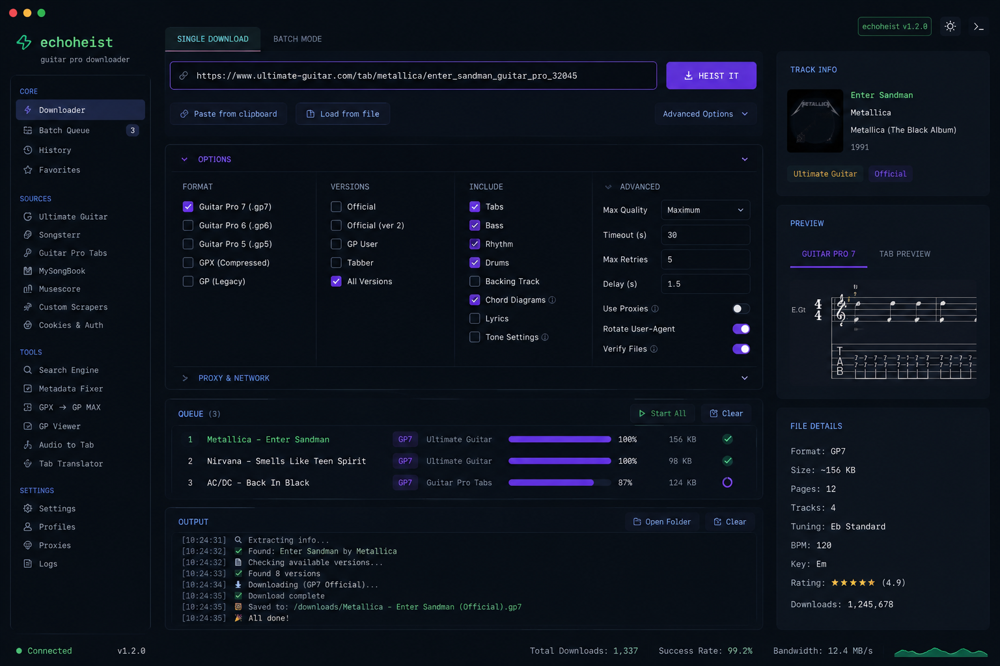
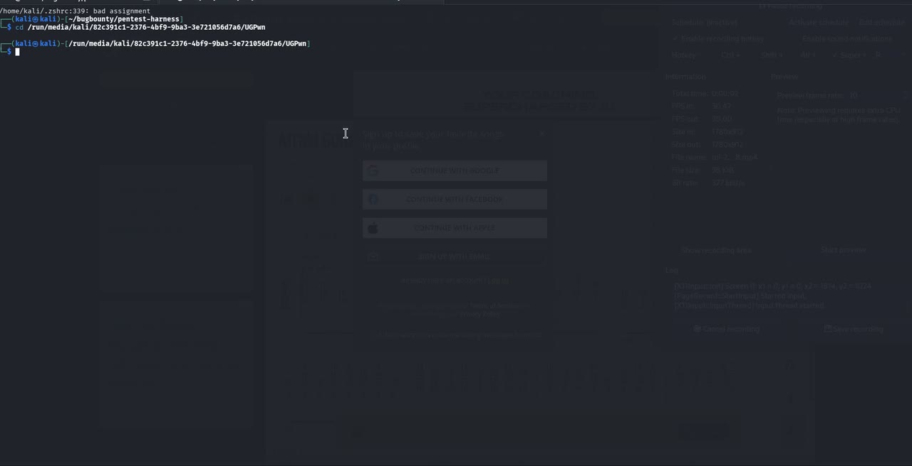

# echoheistv2 — Guitar Pro download authorization PoC

<p align="center">
  
</p>

> [!WARNING]
> **Intentionally broken — this tool cannot download.** The payload path has been
> removed on purpose: the worker reports what the download response *is* (artist,
> song, size, Guitar Pro version) and never writes the file. The finding is
> documented below and still reproduces by hand; running any of this expecting a
> saved `.gp*` file is a user error, and every UI says so.

**Component:** `tabs.ultimate-guitar.com` — tab download route
**Class:** Broken access policy (primary); authentication bypass (secondary)
**Discovered:** 14 January 2025
**Researcher:** `ADMIN [at] DTRH [dot] NET` — <https://dtrh.net>

---

## 1. Summary

Ultimate Guitar gates Guitar Pro (`.gp*` / `.gpx`) downloads behind a sign-in and
entitlement wall in the user interface. The files themselves are served by a
download route on `tabs.ultimate-guitar.com` at:

```
GET https://tabs.ultimate-guitar.com/download/public/<...>
```

The finding is that the decision that is supposed to protect that content is not
enforced by the route that serves it. When a tab page is opened, the page issues
the download request itself; the response returns the Guitar Pro file as an
attachment, with a `Content-Disposition` filename carrying the real extension and
a `Content-Length` describing the whole file. A session that the interface
presents as not entitled to the file still receives the file.

Two consequences follow, and both were demonstrated:

1. **Broken access policy** — the entitlement check lives in the UI flow, not on
   the resource. Navigating a page and reading the response it already made is
   sufficient to obtain the document.
2. **Authentication bypass** — because the download request carries the session's
   own credentials and is issued by the page rather than by a restricted API
   call, capturing and re-issuing it reaches the payload without passing the gate
   the UI enforces.

The original tool, `upstream-echoHEIST.sh`, proved this by capturing the page's
download request and replaying it with `curl`, writing the file to disk.

## 2. Observed flow

```
guest / under-entitled session
  │
  ├─ GET https://tabs.ultimate-guitar.com/tab/<artist>/<song>-<tab id>
  │     (public tab page)
  │
  └─ page issues its own request:
        GET https://tabs.ultimate-guitar.com/download/public/<...>
        ← 200, Content-Type: <guitar pro type>
          Content-Disposition: attachment; filename="<name>.gp5"
          Content-Length: <full file size>
          body: the Guitar Pro file
```

Everything the observation needs is in the response: the server declares the file
name, the Guitar Pro version (from the extension) and the full size. The payload
itself is the part this repository no longer touches.

### Why the response is the evidence

The response is a **full, well-formed Guitar Pro document served to a session the
UI treats as not entitled to it** — not a redirect to a sign-in page, not an error
document, not a watermarked preview. That is the whole finding. Whether the bytes
are written to disk afterwards changes nothing about the access decision that was
made on the server, which is why keeping the payload is not required to prove it.

The tool's payload check corroborates the shape of the response: a Guitar Pro
3/4/5 file begins with the binary magic `FICHIER GUITAR PRO`, and Guitar Pro
6/7/GPX files are ZIP containers (`PK\x03\x04`). The worker verifies both, so a
200 carrying an HTML error or login page cannot be mistaken for the document.

## 3. Evidence a run produces

An observation reports, per tab:

| Field | Source | Example |
|---|---|---|
| artist | tab page / URL slug | `David Bowie` |
| song | tab page / URL slug | `Afraid` |
| size | `Content-Length` of the download response | `48213 bytes` |
| Guitar Pro version | extension in `Content-Disposition`, else content type | `.gp5` |
| content type | response header | `application/octet-stream` |

That tuple establishes the finding: a document exists, it is a Guitar Pro file of
a known version and size, and the server handed it to the session that asked. No
file is written.

## 4. Reproducing the observation by hand

The safest reproduction needs no tooling from this repository — just a browser and
no saved file:

1. Open any Guitar Pro tab page under `https://tabs.ultimate-guitar.com/tab/...`.
2. Open DevTools → **Network**, and filter for `download/public`.
3. Trigger the page's own download action (the button the UI offers).
4. Read the request and its response headers: status, `Content-Type`,
   `Content-Disposition` (filename and extension), `Content-Length`.
5. **Cancel or discard the download.** The observation is complete at step 4; the
   payload is not evidence you need, and it is third-party copyrighted content.

If step 3 returns a sign-in wall for your session, that is the UI gate doing its
job — the finding concerns what the download route itself returns when the page
issues the request, so record the status and headers you actually observe.

## 5. What changed, and why

This repository previously shipped a working downloader: a Puppeteer worker that
read the download response through the Chrome DevTools Protocol, fell back to the
browser's own download directory, and finally re-issued the captured request from
Node with the page's own headers — cookies included.

That last step is the reason the tool no longer downloads anything:

- it retrieved the payload **outside** the browser session the page believed it
  was serving;
- it is the exact mechanism a real attacker would use, so it made this repository
  an exploit kit rather than a write-up;
- it wrote third-party copyrighted files to disk.

`browser/download-worker.mjs` is now **observe-only**. It navigates the page,
records the download request and response headers, and emits a metadata event.
Three things were removed and are guarded by a test
(`browser/worker_contract_test.go`) so they cannot come back silently:

| Removed | Why |
|---|---|
| Replay of the captured request from Node | It is the exploit primitive |
| Any write of the payload to the download directory or a sidecar file | Files are not needed to prove access |
| The `saved` event and `--output-dir` writes | No caller can be handed a file |

`upstream-echoHEIST.sh` is likewise neutralised: it prints artist, song, size and
Guitar Pro version, and its `curl` replay is gone.

The metadata observation is still the full finding, and it is still reproducible.

## 6. How it got here

The tool did not start as a tool. It started as one shell script wrapped around a
browser, and each stage below exists because the previous one ended too early.

**Stage 1 — console only.** The first version was `upstream-echoHEIST.sh` and
nothing else: a short shell script that launched headless Chrome through an inline
`node -e`, waited for the page to request `/download/public/`, printed the
captured URL in the terminal and replayed it with `curl`. That confirmed the
finding and was useless for anything else — one URL at a time, typed by hand.

**Stage 2 — scraping, and fuzzy picking.** You cannot see a catalogue by pasting
URLs into a script, so the next step was scraping: artist lists per letter, songs
per artist, then the tab detail page for the Guitar Pro variants and their
metadata. The scraper reads the JSON the pages already embed instead of parsing
markup, which is where most of its reliability comes from
(`browser/fetcher.go`). Getting the right row out of those lists was the other
half, and fuzzy finding was the interaction that fit — type a few characters, get
the row you meant, press enter. That first picker was a small fzf-driven tool and
was never published; what survives is the behaviour, now built in: the `/` query
bar and a `fuzzyMatch` that mirrors a fuzzy finder's subsequence matching, so no
external binary is needed.

**Stage 3 — the TUI, and tmux.** One row per run was still too slow, so the next
build put the whole result tree on screen: an Ink/React CLI
([`DTRHnet/133748`](https://github.com/DTRHnet/133748), v0.2.0-alpha, changelog
entries from May 2025) with arrow-key navigation, expandable artist/song/tab
nodes, sorting by type, artist, song or tab type, a `grab` command for a single
tab, and the ability to mark several rows and grab them one after another. One
process still shows one view, which is where tmux came in: the picker in one pane,
the worker's output in another, the queue in a third, moving between them instead
of retyping a command. This repository is the same idea folded into one Go
process — `browser/ui.go`: an alphabet strip, artists, songs and their variants, a
preview pane, `Tab` to move focus, `Space`/`v` to queue, `w` to run, and a SQLite
cache so a second visit does not refetch what the first already saw.

**Stage 4 — the dashboard.** 133748 then grew a web side — Express plus a
Vite/React front end with real-time progress and batch downloads — and this
repository's dashboard is the current version of that idea: a Go HTTP server
serving an embedded Preact bundle behind a per-run token, driving the same worker
through a job queue with progress, per-job logs, persisted history and favorites
(`browser/dashboard.go`, `browser/jobs.go`, `web/`). It answers what the TUI could
not — what ran, what failed, what the totals are — and it is the view in the
screenshot at the top of this page.

**Stage 5 — taking the download away.** Every stage above made retrieving the file
easier, which is the wrong direction for something meant to be evidence. The
payload path is gone (§5): the same panes, the same queue, the same dashboard,
now reporting what the response is instead of keeping it.

## 7. Impact

An under-entitled session can obtain Guitar Pro documents that the service
presents as gated. The impact is that of the gated content itself: licensed
third-party transcriptions, distributed in a format the vendor sells access to.
Any party who can open a tab page can take the document, at zero cost and without
completing the flow the service built its entitlement around.

This is an authorization-design defect, not a memory-safety or injection bug:
nothing is corrupted, and no account is taken over.

## 8. Remediation

1. **Enforce entitlement at the resource.** The download route must re-check the
   caller's session and entitlement server-side on every request, and answer
   `403` — not a document — when the check fails. A check performed while
   rendering the page is not a check.
2. **Bind downloads to the session and make them short-lived.** A per-request,
   single-use, expiring token issued to the entitled session prevents a captured
   URL from remaining useful after the entitlement decision was made.
3. **Do not rely on the page to be the enforcement point.** If the route answers
   any session that asks, the UI gate is decoration.
4. **Detect and rate-limit.** Log downloads per session, alert on volume that no
   human browsing pattern produces, and cap concurrent downloads for a session.
5. **Keep the response shape honest.** Returning a full document with
   `Content-Disposition` and `Content-Length` on an unentitled request makes
   automated extraction trivial; a gated response should never describe the size
   and name of the file it is withholding.

## 9. Scope and honesty notes

- **What is claimed:** the observed behaviour of the download route described
  above, as demonstrated with this repository's tooling in January 2025.
- **What is not claimed:** the entitlement model of any specific account tier, the
  current state of the live site, and the vendor's response. None of that is
  evidenced by this repository.
- **One known documentation failure:** earlier documentation of this tool stated
  that it never replayed captured browser requests. That was false. It is recorded
  here because a write-up that hides its own corrections is worthless; see
  [SECURITY.md](SECURITY.md), which is retained for the same reason.
- **Authorization:** everything described here was observed on content the author
  was authorised to access for the purpose of the disclosure. Do not point any
  tooling in this repository at content you are not authorised to retrieve, and do
  not redistribute it — the licence grants no rights (see [LICENSE](LICENSE)).

---

# The tool

Two front ends over one Go core, both observe-only:

- a **terminal UI** (Bubble Tea) for browsing artists → songs → tab variants;
- a **local web dashboard** for the same data with a work queue.

Both drive the same Puppeteer worker, which opens the queued tab and reports what
its download response actually is. It does not save the file.
[SECURITY.md](SECURITY.md) records the residual risks and why the payload path was
removed.

## Requirements

- Go 1.24.2+ (declared in `go.work`, so `GOTOOLCHAIN=auto` fetches it if needed)
- Node.js 20+ with `npm` (CI builds on 22)
- Chrome or Chromium (Puppeteer's bundled Chromium works; otherwise set `CHROME_PATH`)

## Setup

```sh
npm install         # installs Puppeteer for the observation worker
make                # gofmt + vet + tests + binary
```

## Run

```sh
./start.sh              # terminal UI
./start-dashboard.sh    # web dashboard on http://127.0.0.1:8787
```

The dashboard prints a per-run token gate notice at startup. Every `/api` request
requires that run's token, which the served page picks up automatically; there is
no way to reach the API from another origin.

By default the dashboard binds to `127.0.0.1:8787`. Override it with
`ECHOHEIST_LISTEN=127.0.0.1:9090 ./start-dashboard.sh`. Binding it to a
non-loopback address exposes an unauthenticated-by-network tool that can execute a
local script — don't. Requests need the per-run token, but any client that can
reach `/` is served that token, so loopback is the real boundary.

## Web dashboard

The dashboard is a three-column workspace: a navigation rail (`CORE` — Downloader,
Batch Queue, History, Favorites; `SOURCES`; `TOOLS`; `SETTINGS`), a centre column
of cards (URL bar with `HEIST IT`, `OPTIONS`, `QUEUE`, `OUTPUT` console) and a
right-hand panel with `TRACK INFO`, `PREVIEW` and `FILE DETAILS`. A status bar
carries the version, run totals, success rate and byte count.

Navigation entries without an implementation are rendered **disabled with the
reason in a tooltip** — nothing in the UI pretends to work.

Keyboard: `/` search, `j`/`k` move the queue selection, `space` toggle row
selection, `enter` open the tab, `ctrl+enter` queue.

### Options: what is enforced and what is only recorded

| Option | Behaviour |
|---|---|
| Timeout, retries, delay | **Enforced** on the worker: overall deadline, CDP body/navigation attempts, pause before navigation |
| Verify files | **Reported**, not enforced: magic-byte (`FICHIER GUITAR PRO`) / content-type check on the observed response. A failure is logged; there is no file to reject |
| Format | **Preference only** — labels the observed extension; there is no transcoding |
| Versions, include | **Recorded** in the job log; they do not filter a single observation |

The UI states this next to the options row so the controls cannot be mistaken for
conversions the tool does not perform.

## Flags

| Flag | Default | Meaning |
|---|---|---|
| `--download-dir` | `./tabs` | accepted for compatibility; **ignored** — nothing is written |
| `--worker` | `download-worker.mjs` | Puppeteer worker script (see SECURITY.md) |
| `--log-dir` | `./logs` | optional per-run debug logs |
| `--dashboard` | off | run the web dashboard instead of the TUI |
| `--listen` | `127.0.0.1:8787` | dashboard bind address |
| `--version` | | print version/commit/build date and exit |

### Worker flags

The dashboard and the TUI spawn `browser/download-worker.mjs` once per job:

| Flag | Meaning | Enforced? |
|---|---|---|
| `--url`, `--output-dir`, `--artist`, `--song`, `--job-id` | job definition (`--output-dir` is accepted and ignored) | — |
| `--format gp5` | preferred extension label for the observation | **preference only** (no transcoding) |
| `--versions a,b`, `--include x,y` | written into the job log | **recorded only** |
| `--timeout-sec 30` | overall deadline; also bounds the CDP body read | **enforced** |
| `--retries 5` | CDP body attempts and navigation retries | **enforced** |
| `--delay-sec 1.5` | pause before navigating | **enforced** |
| `--verify 1` | magic-byte (`FICHIER GUITAR PRO`), ZIP container or content-type check on the observed response | **reported only** |

The worker emits one `observed` event carrying artist, song, byte count and
extension, then `completed`. It never emits `saved`, never re-issues the captured
request, and never writes to `--output-dir`; `browser/worker_contract_test.go`
enforces all three. Pass `--verify 0` to skip the payload check entirely. Note
that the worker's own defaults for `--timeout-sec`/`--delay-sec` are 0 (no
deadline / no pause): only the dashboard always passes the contract defaults.

### Building from a clean clone

`browser/dashboard/dist` is generated and git-ignored, so `go build ./...` inside
`browser/` fails with an `embed` error until the frontend has been built once.
Use `make` (or `make web`) first.

## Terminal UI controls

| Key | Action |
|---|---|
| arrows / `hjkl` | move through the active pane |
| `Enter` | expand a song row, open the next pane, inspect a variant |
| `Space` or `v` | queue / unqueue the highlighted Guitar Pro variant |
| `w` | run the queue, one observation at a time |
| `x` | cancel the active run, or clear an idle queue |
| `d` | edit the (ignored) download directory |
| `L` | toggle verbose worker logging (unique file under `logs/`) |
| `/` | fuzzy search |
| `y` | copy the selected canonical URL |
| `r` | refresh the current pane |
| `Tab` / `Shift+Tab` | cycle panes |
| `a` / `D` | previous / next artist page |
| `Esc` / `Left` | go back |
| `q` / `Ctrl+C` | quit |

## Watch it run

Two and a half minutes of the terminal UI: browsing an artist, queueing Guitar Pro
variants and running the observation queue. Nothing is saved — each queued tab
ends with an `observed` line and no file.

<p align="center">
  <a href="tui-demo.mp4" title="Play the TUI demo — 2:25, 1280x656, 1.2 MB MP4">
    
  </a>
</p>

<p align="center"><sub><strong>▶ TUI demo</strong> — 2:25 · 1280×656 · 1.2&nbsp;MB MP4 · click the still to play</sub></p>

GitHub does not inline video hosted in a repository, so the still links to
[`tui-demo.mp4`](tui-demo.mp4), which plays in GitHub's own file viewer. Drag the
file into a README editor if you want a player embedded in the page body.

## What a run produces

Nothing on disk. For each queued tab the worker reports:

```
observed  <artist> — <song> · .gp5 · 48213 bytes
```

Artist, song, byte count and the Guitar Pro extension the server declared — the
observation the disclosure rests on. `tabs/` no longer exists as an output
directory: existing directories from earlier builds are left untouched and are
never written to again.

## Development

```sh
make web      # build the Preact dashboard into browser/dashboard/dist
make test     # unit tests (hermetic: no network, no database)
make race     # unit tests under the race detector
make vet      # go vet
make fmt      # gofmt -w
make dist     # versioned tarball + SHA256SUMS under dist/
```

The Go module lives in `browser/`. `download-worker.mjs` at the root is a thin
import shim so the launcher and the module can share one worker implementation.

The web UI is Vite + TypeScript + Preact under `web/`. `make web` builds it into
`browser/dashboard/dist`, which `browser/dashboard.go` embeds with `go:embed`, so
the shipped binary is self-contained — no separate static server. `web/CONTRACT.md`
is the API contract shared by both halves; change it there first.

Tests are hermetic: scrapers, cache, keybindings and dashboard handlers are
exercised without touching the network or the site.

## What this is not

- Not a public release, package, or service.
- Not affiliated with or endorsed by Ultimate Guitar.
- Not a downloader: it observes one documented flow and saves nothing (see
  sections 1–9 above for what the observation proves).
- Not safe to expose beyond loopback (see [SECURITY.md](SECURITY.md)).
